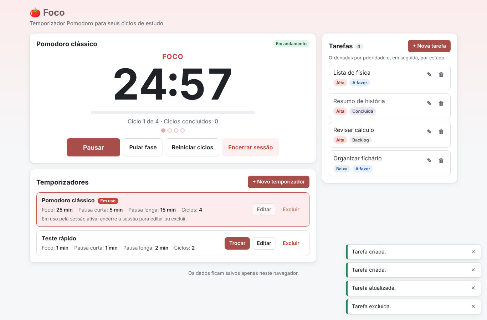
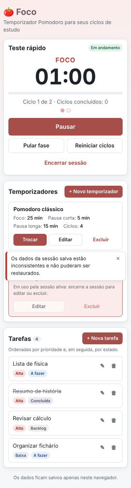

# 🍅 Foco: aplicação web de gestão de foco (Pomodoro)

Aplicação web single-user para organizar ciclos de estudo com a técnica Pomodoro. Ela tem temporizadores personalizados, sessões que continuam depois que o navegador é fechado e um painel lateral de tarefas. Tudo roda no navegador e os dados ficam salvos em `localStorage`.

Trabalho da disciplina de Engenharia de Software, IFNMG, Campus Montes Claros.

| Desktop | Celular |
|---|---|
|  |  |

---

## Como executar

**Pré-requisito:** Node.js 20 ou superior (com npm).

```bash
# 1. instalar as dependências
npm install

# 2. rodar em modo de desenvolvimento (abre em http://localhost:5173)
npm run dev

# 3. rodar os testes unitários do domínio
npm test

# 4. gerar a versão de produção (pasta dist/) e visualizá-la
npm run build
npm run preview
```

| Script | O que faz |
|---|---|
| `npm run dev` | Servidor de desenvolvimento com recarga automática (Vite) |
| `npm run build` | Checa os tipos (`tsc`) e gera o build otimizado em `dist/` |
| `npm run preview` | Serve localmente o conteúdo de `dist/` |
| `npm run typecheck` | Só a verificação de tipos do TypeScript |
| `npm test` | Testes unitários (Vitest) das regras de negócio |

Para testar no celular durante o desenvolvimento, use `npm run dev -- --host` e abra o endereço de rede exibido no terminal.

---

## Deploy no Netlify

Aplicação publicada em: **https://SEU-SITE.netlify.app** _(atualizar com o endereço final)_

O arquivo `netlify.toml` já configura o build (`npm run build`) e a pasta publicada (`dist`).

**Opção recomendada (deploy contínuo pelo GitHub):**
1. No Netlify, clique em **Add new site → Import an existing project → GitHub** e escolha este repositório.
2. As configurações são lidas do `netlify.toml`. Clique em **Deploy**.
3. A cada `git push` na branch principal, o site é atualizado automaticamente.

**Opção manual:** rode `npm run build` e arraste a pasta `dist/` para https://app.netlify.com/drop.

---

## Funcionalidades

**Temporizadores personalizados (RF-01 a RF-04)**
- Criar, editar, excluir e listar presets com nome, tempo de foco, pausa curta, ciclos antes da pausa longa e pausa longa.
- Validação por campo (VR-01 a VR-05), com mensagens em português.
- Um preset usado por uma sessão ativa fica com edição e exclusão bloqueadas, e a tela explica o motivo (RN-01).

**Sessão de foco (RF-05 a RF-11, RF-14)**
- Fases de foco, pausa curta e pausa longa, com relógio, barra de progresso e indicador de ciclos.
- Controles: pausar, retomar, pular fase, reiniciar ciclos (com confirmação) e encerrar sessão (com confirmação).
- Escolher outro preset encerra a sessão atual e inicia a nova sem pedir confirmação (RN-02).
- Alerta sonoro (três bipes) ao fim de cada fase (RN-13).
- O tempo restante aparece no título da aba.

**Persistência e retomada (RF-12, RF-13)**
- A sessão é restaurada ao reabrir o navegador. As fases que venceram enquanto ele estava fechado são recalculadas por timestamp (RN-07, RN-08).
- Uma sessão que estava pausada volta pausada (RN-06).
- Uma faixa avisa que a sessão foi retomada e oferece o botão **Descartar sessão** (UC11).
- Se os dados salvos estiverem corrompidos, a aplicação avisa e oferece o descarte (R-03).

**Tarefas (RF-15 a RF-20)**
- Painel à direita do temporizador no desktop e abaixo dele no celular.
- Criar, editar e excluir tarefas com título, estado e prioridade. Novas tarefas começam em *Backlog* com prioridade *Média* (RN-12).
- Ordenação fixa: prioridade (alta → baixa) e depois estado (a fazer → em execução → concluída → cancelada → backlog), conforme RN-10.
- Toda exclusão pede confirmação explícita (RN-11).

---

## Estrutura do projeto

```
src/
├── domain/              # Regras de negócio puras (sem React, sem localStorage)
│   ├── tipos.ts         # Entidades do modelo conceitual (seção 11 do documento)
│   ├── sessao.ts        # Máquina de estados da sessão (iniciar, pausar, pular, sincronizar...)
│   ├── presets.ts       # Validação e criação de presets (VR-01 a VR-05)
│   ├── tarefas.ts       # Validação e ordenação de tarefas (VR-06 a VR-08, RN-10)
│   └── id.ts            # Geração de identificadores
├── persistence/         # Acesso ao localStorage
│   ├── armazenamento.ts # Leitura/gravação segura de JSON e tratamento de falhas
│   └── repositorios.ts  # Um repositório por chave (pomodoro.presets/tarefas/sessaoAtiva)
├── hooks/               # Ligação entre domínio, persistência e React
│   ├── useSessao.ts     # Relógio, transições da sessão e retomada automática
│   ├── usePresets.ts
│   ├── useTarefas.ts
│   └── useColecaoPersistida.ts
├── audio/alerta.ts      # Alerta sonoro com Web Audio API
├── components/          # Interface
│   ├── Temporizador.tsx, ListaPresets.tsx, PainelTarefas.tsx
│   ├── FormularioPreset.tsx, FormularioTarefa.tsx, CampoFormulario.tsx
│   └── Modal.tsx, Confirmacao.tsx, Notificacoes.tsx
├── App.tsx              # Composição da tela
├── main.tsx             # Ponto de entrada
└── estilos.css          # Estilos próprios (sem biblioteca CSS)
tests/                   # Testes unitários do domínio (Vitest)
```

---

## Decisões técnicas

1. **React + TypeScript com Vite.** O Vite inicia rápido, tem build otimizado e já vem configurado para TypeScript e JSX. O TypeScript roda em modo `strict`.

2. **Separação em camadas (RNF-09).** As regras de negócio ficam em `src/domain/` como **funções puras**: recebem o estado e o instante atual (`agora`) e devolvem um novo estado. Elas não dependem de React, do relógio do sistema nem do `localStorage`, então dá para testá-las isoladamente. Por exemplo, os testes simulam "o navegador ficou fechado 40 minutos" sem esperar 40 minutos. Só a pasta `persistence/` conhece as chaves do `localStorage`, e os componentes só falam com os hooks.

3. **Tempo calculado por timestamps absolutos (RNF-03, R-02).** A sessão guarda `inicioFaseEm` e `fimFasePrevistoEm` em milissegundos. O tempo restante é sempre `fimFasePrevistoEm − Date.now()`, nunca um contador decrementado por `setInterval`. O intervalo de 250 ms serve só para redesenhar a tela. Assim o relógio não atrasa quando o navegador desacelera abas em segundo plano. Quando uma fase vence, a próxima começa no exato instante em que a anterior terminou. Por isso, ao reabrir o navegador, a função `sincronizarSessao` percorre todas as fases vencidas e chega ao mesmo estado que teria se a aba continuasse aberta.

4. **Snapshot do preset (RN-05).** Ao iniciar, a sessão copia os parâmetros do preset para `snapshotPreset`. Editar o preset depois não afeta a sessão em curso.

5. **Persistência defensiva (RNF-06, R-03).** Toda gravação passa por `gravarJson`, que transforma falhas (cota excedida, modo privado) em `ErroPersistencia`. A interface mostra essas falhas como notificação. Na leitura, cada entidade é validada por um *type guard* (`ehSessaoValida`, `ehPresetValido`, `ehTarefaValida`). Se a sessão estiver inconsistente, ela não é carregada e o usuário recebe a opção de descartá-la.

6. **Alerta sonoro com Web Audio API (RNF-10, R-01).** Os bipes são gerados por um oscilador, sem arquivo de áudio. Os navegadores só liberam som depois de uma interação, então o `AudioContext` é criado/ativado nos cliques de **Iniciar** e **Retomar**, o que mantém o contexto liberado para os alertas seguintes.

7. **Acessibilidade (RNF-07).** Os modais usam o elemento nativo `<dialog>`, que já traz foco preso, fechamento com `Esc` e semântica correta. Todos os campos têm `<label>`, erros ligados por `aria-describedby` e `aria-invalid`, e o foco vai para o primeiro campo inválido. Botões de ícone têm `aria-label` com o nome do item, e a barra de progresso usa `role="progressbar"`. Tudo funciona pelo teclado.

8. **CSS próprio, sem biblioteca.** As cores mudam conforme a fase (vermelho no foco, verde na pausa curta, azul na pausa longa) por meio de variáveis CSS. O layout usa CSS Grid com um único ponto de quebra (960 px): acima dele o painel de tarefas fica à direita e fixo na tela, abaixo dele vai para baixo do temporizador.

9. **Estado sem biblioteca externa.** O escopo é pequeno (três coleções e uma sessão), então hooks próprios bastam. Contextos React são usados só para os serviços transversais de confirmação e notificação.

### Interpretações do documento de requisitos

Pontos em que o documento era ambíguo ou contraditório, e a decisão tomada:

| Ponto | Decisão |
|---|---|
| **Fim da sessão.** O documento fala em "conclusão da sessão" (UC06, RN-08). | A sessão tem `N` ciclos de foco. Os `N−1` primeiros são seguidos de pausa curta e o último de pausa longa. Ao fim da pausa longa a sessão fica **concluída**. |
| **Contagem de ciclos x RN-03.** Se a contagem fosse só `cicloAtual`, pular uma pausa levaria ao próximo ciclo e "incrementaria" a contagem. | Foi criado o campo `ciclosConcluidos`, separado da posição (`cicloAtual`). Um ciclo só conta quando o foco **e** a pausa terminam sem ser pulados. O campo auxiliar `focoPuladoNoCiclo` registra se o foco foi pulado. |
| **Ordem dos estados: RF-19 x RN-10.** RF-19 coloca *backlog* primeiro e RN-10 o coloca por último. | Seguimos a **RN-10**, que o próprio documento chama de "ordenação fixa" e que a RT-06 e o UC15 referenciam. |
| **Sessão concluída bloqueia o preset?** | Não. Só sessões *em andamento* ou *pausadas* bloqueiam edição e exclusão (RN-01). A sessão concluída fica visível até o usuário clicar em **Fechar** ou **Iniciar novamente**. |
| **Pular fase com a sessão pausada.** | A sessão avança para a próxima fase e continua pausada, com o tempo cheio da nova fase. |
| **Primeiro acesso.** | Dois presets de exemplo ("Pomodoro clássico" 25/5/4/15 e "Estudo longo" 50/10/3/30) são criados se ainda não houver nada salvo. Eles podem ser editados ou excluídos normalmente. |
| **Som ambiente.** | Não implementado (opcional pelo enunciado). |

---

## Divisão de responsabilidades da equipe

| Integrante | Responsabilidade | Arquivos principais |
|---|---|---|
| **Lucas de Lima Santos** | Configuração do projeto; domínio da sessão (máquina de estados e recálculo por timestamp); persistência em localStorage e retomada automática; alerta sonoro; componente do temporizador; testes da sessão; documentação | `src/domain/sessao.ts`, `src/domain/tipos.ts`, `src/persistence/*`, `src/hooks/useSessao.ts`, `src/hooks/useColecaoPersistida.ts`, `src/audio/alerta.ts`, `src/components/Temporizador.tsx`, `tests/sessao.test.ts`, `README.md` |
| **Edinei Lucas Silva Souza** | Temporizadores personalizados (validação, CRUD, formulário e lista); tarefas (validação, ordenação e painel lateral); componentes de interface compartilhados (modal, confirmação, notificações); layout responsivo, acessibilidade e estilos; testes de presets e tarefas | `src/domain/presets.ts`, `src/domain/tarefas.ts`, `src/hooks/usePresets.ts`, `src/hooks/useTarefas.ts`, `src/components/ListaPresets.tsx`, `FormularioPreset.tsx`, `PainelTarefas.tsx`, `FormularioTarefa.tsx`, `Modal.tsx`, `Confirmacao.tsx`, `Notificacoes.tsx`, `CampoFormulario.tsx`, `src/App.tsx`, `src/estilos.css`, `tests/presets-tarefas.test.ts` |

### Boas práticas adotadas
- **Commits pequenos e por funcionalidade**, cada um feito pelo integrante responsável pela parte.
- **Commits semânticos** (`feat:`, `fix:`, `test:`, `docs:`, `refactor:`).
- **TypeScript estrito** (`strict`, `noUnusedLocals`, `noUnusedParameters`).
- **Testes automatizados** das regras de negócio críticas (RN-03 a RN-08, RN-10, RN-12, validações).
- **Rastreabilidade:** comentários no código citam os identificadores do documento (RF, RN, UC, VR, RNF).
